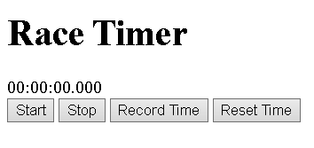

Basic Timer Application
This is a basic race timer application worked on during my Computer Science degree at the University of Portsmouth. It allows users to start, stop and reset a timer, as well as record their times.

Technologies Used
- JavaScript
- HTML
- Node
- Express 
- SQLite

Features
- Start and stop the timer
- Display the elapsed time in hours, minutes, seconds and milliseconds
- Reset the timer
- Record times in the browser console
- Backend API endpoints for saving, viewing and clearing race results
- SQLite database setup for storing race results 

How to Run

1. Install Node.js
2. Download or clone the repository
3. Open the project folder in a terminal
4. Install the dependencies using npm install
5. Run the server using node server.js
6. Open raceapp.html in your browser to use the application

What I learned
This project provided experience with JavaScript, handling button clicks, updating the page using the DOM, and calculating elapsed time. I worked with Node.js, Express and SQLite for the first time to create the backend and database. This was my first exposure to new technologies.

Future Improvements
- Add a user interface for viewing and managing recorded times
- Connecting the timer interface to the database to view saved times directly in the application
- Updated UI with better styling and an improved user experience

## Screenshot
